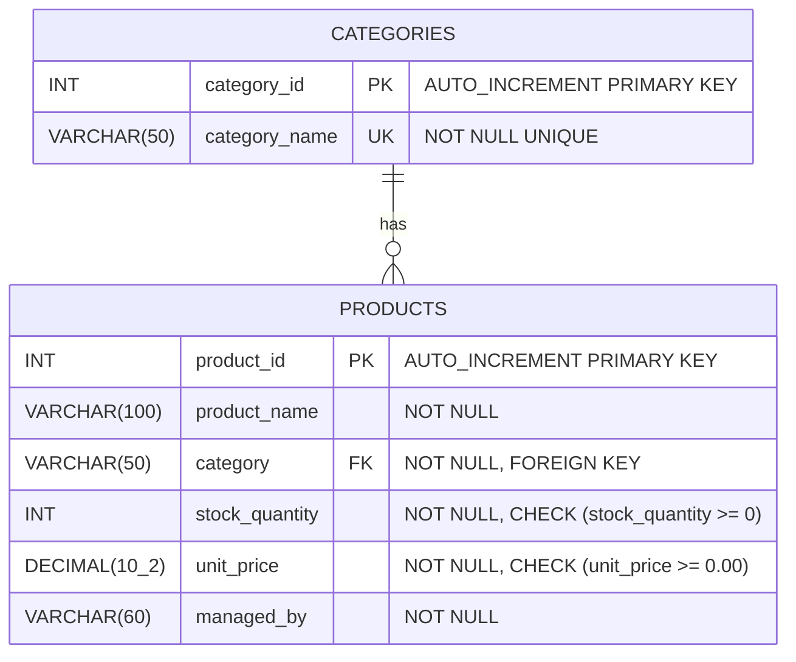
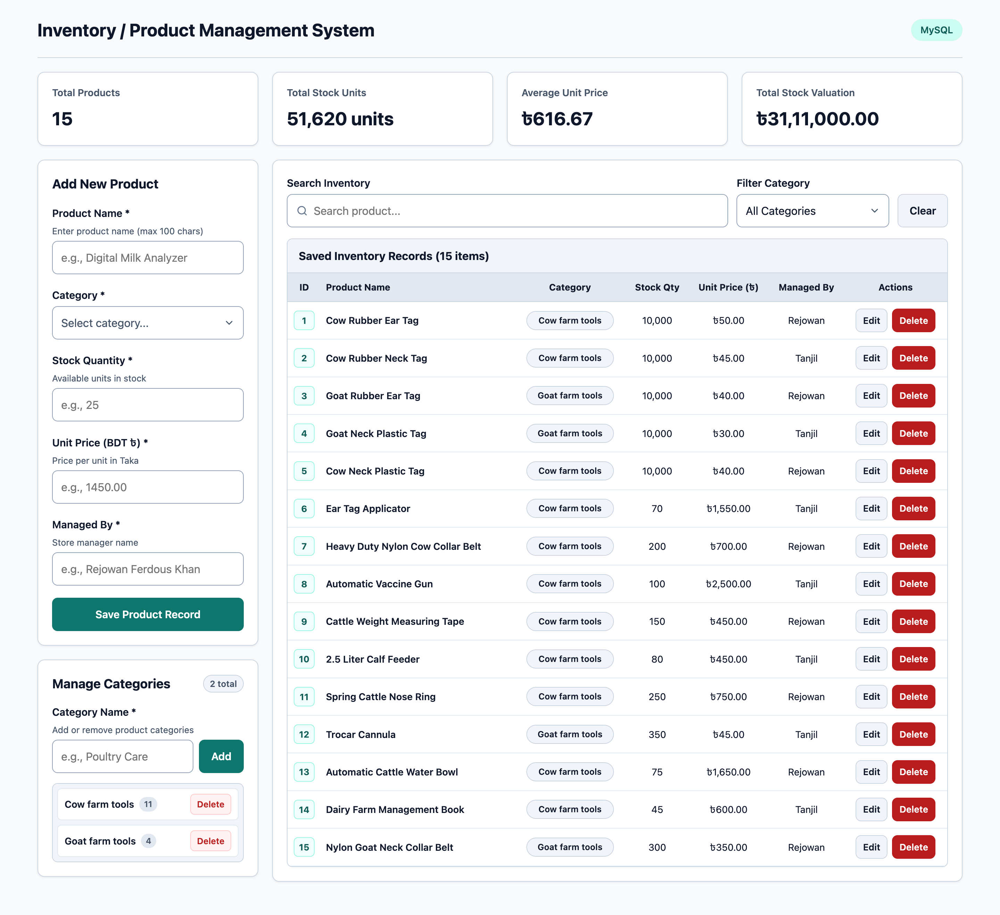
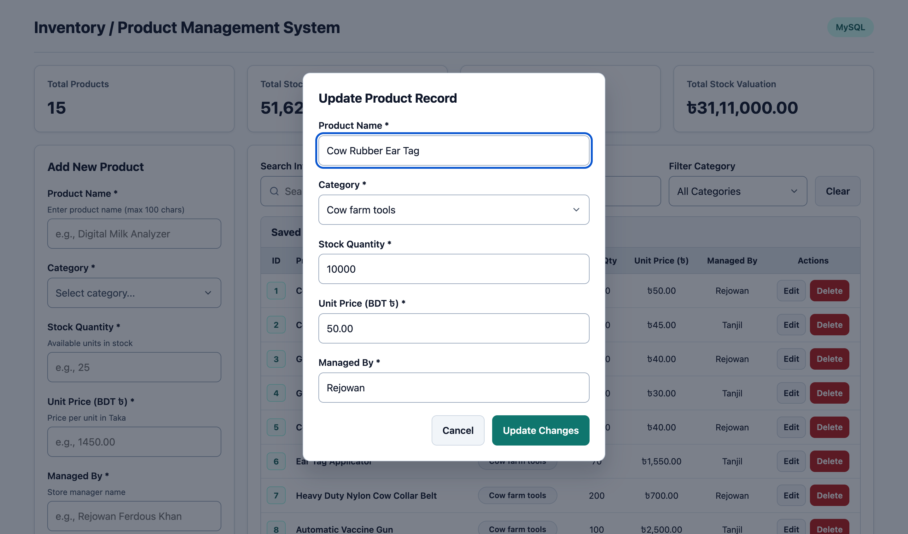

<div align="center">

# FENI UNIVERSITY
### Department of Computer Science and Engineering (CSE)
**Program:** Undergraduate Bachelor of Science (B.Sc. in CSE)

---

### LAB PROJECT REPORT
**Course Title:** Database Management System Lab

<br>

## **Project Title: Inventory / Product Management System**

<br>

---

| **Submitted By** | **Submitted To** |
| :--- | :--- |
| **Name:** Rejowan Ferdous Khan | **Name:** Faria Sultana Bintha Rohman |
| **Student ID:** 251031024 | **Designation:** Lab Technical Officer (LTO) |
| **Batch:** CSE 34th Batch | **Department:** B.Sc. in CSE, Feni University |
| **Program:** B.Sc. in CSE | |
| **Department:** Dept. of CSE, Feni University | |

<br>

**Date of Submission:** November 05, 2026

</div>

<div style="page-break-after: always;"></div>

---

## 1. Project Objective

The objective of this project is to develop a small, single-page web application connected to a relational database to store, retrieve, update, and delete inventory records. The system demonstrates practical use of SQL commands (`CREATE`, `INSERT`, `SELECT`, `WHERE`, `UPDATE`, `DELETE`) and SQL aggregate functions (`COUNT()`, `SUM()`, `AVG()`) through a clean and simple user interface.

### Key Features Implemented:
1. **Add Records:** Users can add new products and create product categories from the web interface.
2. **View Records:** Saved products are displayed in a structured table on the same page.
3. **Search and Filter:** Users can search products by ID, name, category, or manager name, and filter items by category using SQL `WHERE` and `LIKE` conditions.
4. **Update Records:** Existing product details can be edited and saved using a modal form.
5. **Delete Records:** Unused categories and product records can be deleted after a confirmation message.
6. **Summary Information:** Displays total products (`COUNT`), total stock quantity (`SUM`), average unit price (`AVG`), and total stock valuation (`SUM`).

---

## 2. Tools Used & Project File Structure

### 2.1 Technology Stack

| Component | Technology | Description |
| :--- | :--- | :--- |
| **Frontend** | HTML5, CSS3, JavaScript (`index.html`, `style.css`, `script.js`) | Single-page user interface, forms, data table, search bar, and modal dialogs. |
| **Backend** | Node.js, Express (`server.js`) | REST API server handling HTTP requests and executing SQL queries. |
| **Database Driver** | `mysql2` | Connects Node.js with the MySQL database using parameterized queries. |
| **Database** | MySQL (`inventory_db`) | Relational database storing the `categories` and `products` tables. |

### 2.2 Project File Structure

```text
Inventory-Product-Management-System/
├── database.sql
├── server.js
├── package.json
├── LAB_REPORT.md
├── public/
│   ├── index.html
│   ├── style.css
│   └── script.js
└── screenshots/
    ├── dashboard-overview.png
    └── edit-record-modal.png
```

---

## 3. Database Table Design & ER Diagram

### 3.1 Entity-Relationship (ER) Diagram
The database `inventory_db` consists of two related tables: `categories` (parent table) and `products` (child table). Each category can have multiple products (`1:N` relationship), linked by a `FOREIGN KEY` on `products.category` referencing `categories(category_name)`.



### 3.2 Table Structure

| Table | Column Name | Data Type | Constraints | Description |
| :--- | :--- | :--- | :--- | :--- |
| `categories` | `category_id` | `INT` | `PRIMARY KEY`, `AUTO_INCREMENT` | Unique ID for each category |
| `categories` | `category_name` | `VARCHAR(50)` | `NOT NULL`, `UNIQUE` | Category name |
| `products` | `product_id` | `INT` | `PRIMARY KEY`, `AUTO_INCREMENT` | Unique ID for each product |
| `products` | `product_name` | `VARCHAR(100)` | `NOT NULL` | Name of the product |
| `products` | `category` | `VARCHAR(50)` | `NOT NULL`, `FOREIGN KEY` | References `categories(category_name)` |
| `products` | `stock_quantity` | `INT` | `NOT NULL`, `CHECK (>= 0)` | Available quantity in stock |
| `products` | `unit_price` | `DECIMAL(10, 2)` | `NOT NULL`, `CHECK (>= 0.00)` | Unit price in BDT (`৳`) |
| `products` | `managed_by` | `VARCHAR(60)` | `NOT NULL` | Name of the store manager |

---

## 4. Key SQL Queries (`database.sql` & `server.js`)

### 4.1 Database and Table Creation (`CREATE`)
```sql
CREATE DATABASE IF NOT EXISTS inventory_db
    CHARACTER SET utf8mb4
    COLLATE utf8mb4_unicode_ci;

USE inventory_db;

CREATE TABLE IF NOT EXISTS categories (
    category_id INT AUTO_INCREMENT PRIMARY KEY,
    category_name VARCHAR(50) NOT NULL UNIQUE
);

CREATE TABLE IF NOT EXISTS products (
    product_id INT AUTO_INCREMENT PRIMARY KEY,
    product_name VARCHAR(100) NOT NULL,
    category VARCHAR(50) NOT NULL,
    stock_quantity INT NOT NULL CHECK (stock_quantity >= 0),
    unit_price DECIMAL(10, 2) NOT NULL CHECK (unit_price >= 0.00),
    managed_by VARCHAR(60) NOT NULL,
    CONSTRAINT fk_products_category
        FOREIGN KEY (category) REFERENCES categories(category_name)
        ON UPDATE CASCADE
        ON DELETE RESTRICT
);
```

### 4.2 Sample Data Insertion (`INSERT`)
```sql
INSERT INTO categories (category_name) VALUES
('Cow farm tools'),
('Goat farm tools');

INSERT INTO products (product_name, category, stock_quantity, unit_price, managed_by) VALUES
('Cow Rubber Ear Tag', 'Cow farm tools', 10000, 50.00, 'Rejowan'),
('Cow Rubber Neck Tag', 'Cow farm tools', 10000, 45.00, 'Tanjil'),
('Goat Rubber Ear Tag', 'Goat farm tools', 10000, 40.00, 'Rejowan'),
('Goat Neck Plastic Tag', 'Goat farm tools', 10000, 30.00, 'Tanjil'),
('Cow Neck Plastic Tag', 'Cow farm tools', 10000, 40.00, 'Rejowan'),
('Ear Tag Applicator', 'Cow farm tools', 70, 1550.00, 'Tanjil'),
('Heavy Duty Nylon Cow Collar Belt', 'Cow farm tools', 200, 700.00, 'Rejowan'),
('Automatic Vaccine Gun', 'Cow farm tools', 100, 2500.00, 'Tanjil'),
('Cattle Weight Measuring Tape', 'Cow farm tools', 150, 450.00, 'Rejowan'),
('2.5 Liter Calf Feeder', 'Cow farm tools', 80, 450.00, 'Tanjil'),
('Spring Cattle Nose Ring', 'Cow farm tools', 250, 750.00, 'Rejowan'),
('Trocar Cannula', 'Goat farm tools', 350, 45.00, 'Tanjil'),
('Automatic Cattle Water Bowl', 'Cow farm tools', 75, 1650.00, 'Rejowan'),
('Dairy Farm Management Book', 'Cow farm tools', 45, 600.00, 'Tanjil'),
('Nylon Goat Neck Collar Belt', 'Goat farm tools', 300, 350.00, 'Rejowan');
```

### 4.3 View Records and Categories (`SELECT`)
```sql
SELECT c.category_id, c.category_name, COUNT(p.product_id) AS product_count
FROM categories c
LEFT JOIN products p ON p.category = c.category_name
GROUP BY c.category_id, c.category_name
ORDER BY category_name ASC;

SELECT product_id, product_name, category, stock_quantity, unit_price, managed_by
FROM products
ORDER BY product_id ASC;
```

### 4.4 Search and Filter Records (`SELECT` with `WHERE` and `LIKE`)
```sql
SELECT product_id, product_name, category, stock_quantity, unit_price, managed_by
FROM products
WHERE (product_id = 1 OR product_name LIKE '%Tag%' OR category LIKE '%Tag%' OR managed_by LIKE '%Tag%')
  AND category = 'Cow farm tools'
ORDER BY product_id ASC;
```

### 4.5 Update Record (`UPDATE` with `WHERE`)
```sql
UPDATE products
SET product_name = 'Cow Rubber Ear Tag',
    category = 'Cow farm tools',
    stock_quantity = 10000,
    unit_price = 50.00,
    managed_by = 'Rejowan'
WHERE product_id = 1;
```

### 4.6 Delete Record (`DELETE` with `WHERE`)
```sql
DELETE FROM products
WHERE product_id = 15;

DELETE FROM categories
WHERE category_id = 2;
```

### 4.7 Summary Queries Using Aggregate Functions (`COUNT`, `SUM`, `AVG`)
```sql
SELECT
    COUNT(*) AS total_products,
    COALESCE(SUM(stock_quantity), 0) AS total_stock,
    COALESCE(ROUND(AVG(unit_price), 2), 0) AS average_price,
    COALESCE(ROUND(SUM(stock_quantity * unit_price), 2), 0) AS total_inventory_value
FROM products;
```

| Total Products (`COUNT(*)`) | Total Stock Units (`SUM(stock_quantity)`) | Average Unit Price (`AVG(unit_price)`) | Total Stock Valuation (`SUM(qty * price)`) |
| :---: | :---: | :---: | :---: |
| **15** | **51,620 units** | **৳616.67** | **৳31,11,000.00** |

---

## 5. Screenshots of the Working Application

### Figure 1: Main Single-Page Inventory Interface


### Figure 2: Update Product Record Modal


---

## 6. How to Run the Project

1. **Database Setup:** Start the local MySQL server (e.g., via XAMPP or MySQL Server on `localhost:3306` with user `root`). Import `database.sql` in phpMyAdmin or MySQL CLI (`mysql -u root < database.sql`), or simply start the server and it will run `database.sql` automatically on first launch.
2. **Install Packages and Start Server:** Open a terminal in the project folder and run:
   ```bash
   npm install
   npm start
   ```
3. **Open in Browser:** Go to `http://localhost:3000` in any web browser.

---

## 7. Conclusion

This project successfully implements a single-page Inventory / Product Management System using HTML, CSS, JavaScript, Node.js, and MySQL. It fulfills all course requirements by demonstrating relational table design with primary and foreign keys, complete CRUD operations, search and category filtering with `WHERE` clauses, and live summary calculations using SQL aggregate functions.
